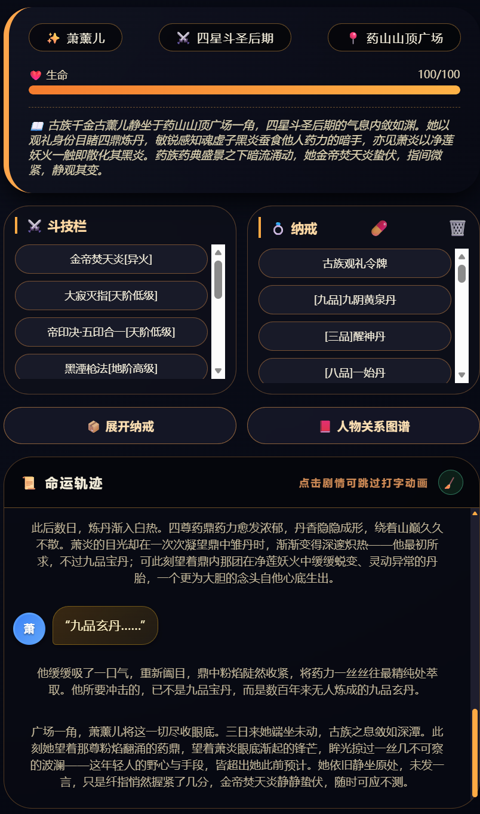
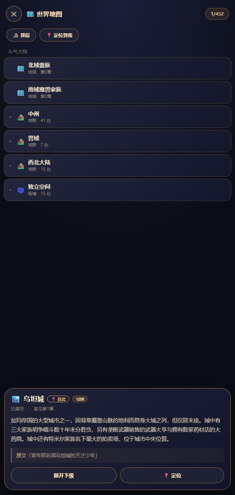
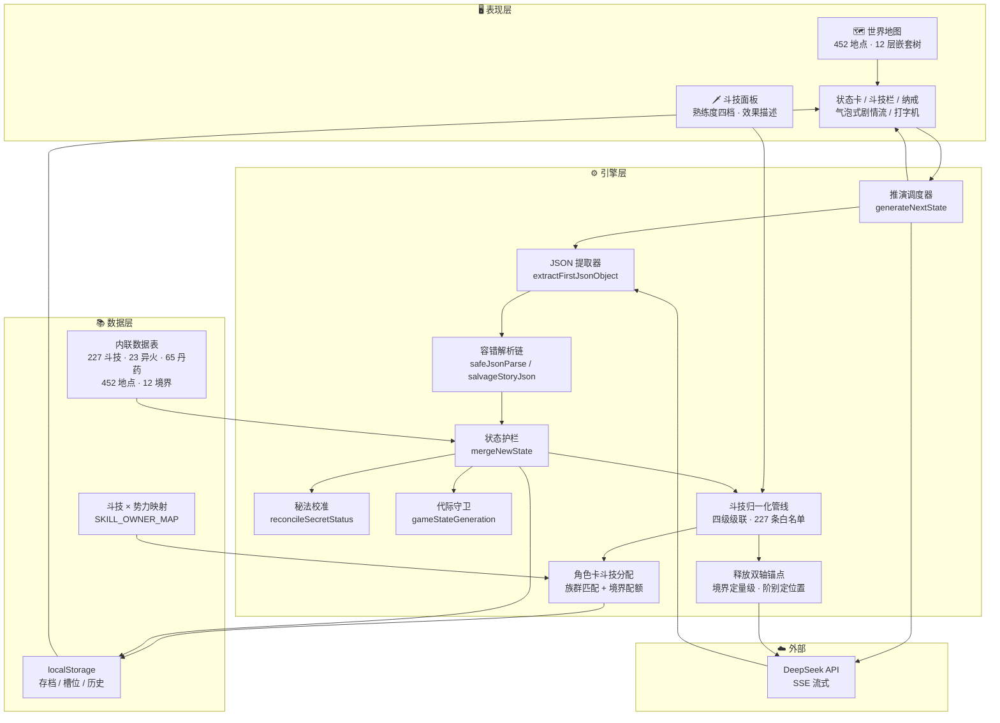
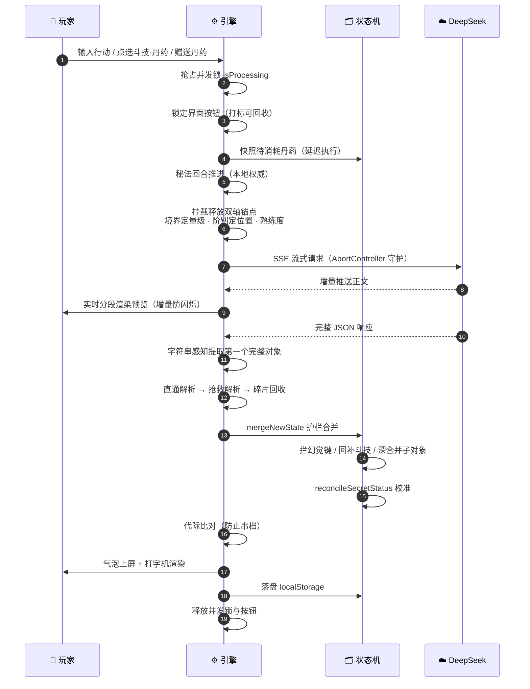
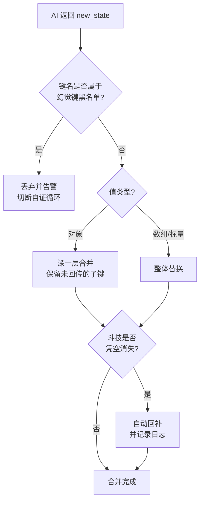

<div align="center">

# 斗破苍穹 · AI 命运推演引擎

### Doupo Cangqiong · AI Narrative Engine

**把 227 条斗技、23 种异火、65 味丹药、452 处地点、123 章剧情大纲，全部装进一个 3.26 MB 的 HTML 文件**

**23,000 行原生 JavaScript 手写引擎 · 零依赖 · 零构建 · 双击即玩**



[](#-快速开始)
[](#-架构)
[](#-实证结果)
[](#-架构)
[](#-快速开始)
[](#-快速开始)

[**立即试玩**](#-快速开始) · [**核心机制**](#-工程挑战与解法) · [**数据资产**](#-数据资产) · [**常见问题**](#-常见问题-faq)

</div>

---

## 摘要 | Abstract

**斗破苍穹 · AI 命运推演引擎**是一款运行在浏览器中的**大语言模型（LLM）驱动文字冒险游戏（Interactive Fiction / Text Adventure）**。它以天蚕土豆的网络小说《斗破苍穹》（*Battle Through the Heavens*, BTTH）为世界观基底，通过 DeepSeek API 实时生成剧情，由本地代码维护一份**强一致的结构化游戏状态**（境界、斗技、异火、丹药、秘法、人物关系）。

与传统"聊天式"角色扮演不同，本引擎的核心命题是：**如何在不可靠的 LLM 输出之上，构建一个状态永不错乱、进度永不丢失的游戏系统。**

为此，项目用 **23,104 行原生 JavaScript** 手工实现了三层工程防护：LLM 输出的**字符串感知 JSON 容错链**、游戏状态的**护栏式合并（guarded merge）**、以及异步任务的**代际校验（generation guard）**。整个系统零框架、零构建步骤、零运行时依赖，可完全离线运行（仅推演需联网调用模型）。

> **English abstract** — A single-file, dependency-free, LLM-driven interactive fiction engine based on the Chinese web novel *Battle Through the Heavens*. It solves three classes of reliability problems that plague LLM game masters: malformed structured output, state drift between turns, and race conditions between background tasks and save-file switching.

---

## 目录

- [界面预览](#-界面预览)
- [1. 系统概览](#1-系统概览)
- [2. 架构](#-架构)
- [3. 数据资产](#-数据资产)
- [4. 工程挑战与解法](#-工程挑战与解法)
- [5. 实证结果](#-实证结果)
- [6. 快速开始](#-快速开始)
- [7. 玩法与模式](#-玩法与模式)
- [8. 境界体系](#-境界体系)
- [9. 常见问题 FAQ](#-常见问题-faq)
- [10. 路线图](#-路线图)
- [11. 引用与声明](#-引用与声明)
- [12. 更新日志](#12-更新日志-changelog)

---

## 界面预览

<div align="center">

<table>
<tr>
<td width="33%" align="center"></td>
<td width="34%" align="center"></td>
<td width="33%" align="center"></td>
</tr>
<tr>
<td align="center"><sub><b>主菜单</b><br/>三种模式入口</sub></td>
<td align="center"><sub><b>推演界面</b><br/>状态卡 · 斗技栏 · 纳戒 · 命运轨迹</sub></td>
<td align="center"><sub><b>世界地图</b><br/>452 处地点 · 12 层嵌套树</sub></td>
</tr>
</table>

</div>

上图中的**每一处信息都由代码维护，而非模型记忆**。这正是本项目与"直接和 AI 聊天扮演角色"的根本区别：

| 界面元素 | 数据来源 | 背后的防护机制 |
|:---|:---|:---|
| `四星斗圣后期` | 境界状态机 | 23 阶段时间线约束 + 秘法回合校准 |
| `[异火] 金帝焚天炎` | 23 种异火表 | 异火归属校验 |
| `大寂灭指[天阶低级]` | 227 条斗技表 | 归属校验 + 14 种写法归一 + 丢失自动回补 |
| `帝印决·五印合一[天阶低级]` | 古族帝印决系列 | 阶别上限校验（斗圣每档可拥有天阶数量受限） |
| `[九品]九阴黄泉丹` | 65 味丹药表 | 九品分级 + 名称格式归一 |
| 命运轨迹分段气泡 | 模型实时生成 | 按 `【角色名】` 切分 + HTML 转义 + 打字机渲染 |
| 旁白与角色对话分色 | 段落类型识别 | `parseStoryToSegments` 分类渲染 |

> **注意斗技栏与纳戒的分栏规则**：斗技、异火、秘法进"斗技栏"；丹药、令牌等杂物进"纳戒"。这个分类不是模型决定的，而是引擎按 `名称[阶别]` 与 `[品级]名称` 的格式特征自动判定的——所以模型一旦把格式写错，东西就会跑到错误的分栏里去。这正是第 4.2 节那套归一化机制要解决的问题。

---

## 1. 系统概览

### 1.1 一句话定义

一个**没有服务器、没有数据库、没有 npm 依赖**的 AI 文字冒险引擎——双击 `index.html` 即玩，存档存在浏览器本地。

全部 **23,104 行**代码、**282 个函数**、四张内联数据表，压缩在同一个 HTML 文件里：没有 Webpack，没有 `npm install`，没有 `node_modules`。

### 1.2 关键指标

| 维度 | 指标 | 数值 |
|:---|:---|:---|
| **交付形态** | 文件数量 | **1** 个 HTML |
| | 文件体积 | **3.26 MB**（3,415,104 字节） |
| | 外部依赖 | **0** |
| | 构建步骤 | **无** |
| **代码规模** | 总行数 | 23,104 行 |
| | 总字符数 | 1,950,000 |
| | 函数定义 | 159 个（其中 async 26 个） |
| | 异常保护块 | 45 处 try/catch |
| | 中文注释 | 332 处 |
| **内容资产** | 斗技条目 | **227** 条 |
| | 异火条目 | **23** 种（对应原著完整异火榜） |
| | 丹药条目 | **65** 味（九品完整分级） |
| | 降临剧情大纲 | **4** 部 / **123** 章 |
| | 时间线阶段 | **23** 个（覆盖斗之气 → 斗帝全程） |
| **可靠性** | 回归测试 | **62** 项全部通过 |
| | 已修复缺陷 | 28 类（三轮迭代） |

### 1.3 它解决了什么问题

市面上的 AI 角色扮演方案普遍存在三类失效模式，本引擎针对性地给出了工程解：

| 失效模式 | 典型表现 | 本引擎的解法 |
|:---|:---|:---|
| **结构化输出不可靠** | 模型把 JSON 写成散文、截断、混入 markdown 围栏，导致状态整回合丢失 | 字符串感知的 JSON 提取与修复链 |
| **状态漂移** | 上一回合还在的武器/技能，下一回合凭空消失 | 护栏式状态合并 + 关键资产回补 |
| **异步竞态** | 后台任务在玩家读档后写入旧数据，污染新存档 | 代际（generation）校验 |

---

## 2. 架构

### 2.1 总体架构



### 2.2 单个回合的完整生命周期



### 2.3 状态合并决策流



### 2.4 技术选型

| 层 | 选择 | 理由 |
|:---|:---|:---|
| 运行时 | 原生 JavaScript（ES2020+） | 零构建、零依赖、双击即玩 |
| 渲染 | 原生 DOM + CSS | 无框架开销，移动端友好 |
| 模型 | DeepSeek API | 中文叙事质量与推理成本的最优平衡 |
| 传输 | SSE 流式 | 首字延迟从数秒降至约 1 秒 |
| 存档 | localStorage | 无服务端，隐私数据不出本机 |
| 图形 | 内联 SVG / Canvas 粒子 | 无外部图片资源 |

---

## 3. 数据资产

引擎内嵌四张结构化数据表，全部以 JSON 字面量形式硬编码在文件内，**无需任何外部数据文件或网络查询**。

### 3.1 斗技表（COMBAT_SKILLS）

| 阶别 | 条目数 | 说明 |
|:---|:---:|:---|
| 超天阶 | 6 | 斗帝级手段与帝器 |
| 天阶 | 17 | 分低/中/高级，含古族帝印决系列 |
| 地阶 | 37 | 分低/中/高级 |
| 玄阶 | 101 | 出场频率最高的阶别 |
| 黄阶 | 19 | 入门级斗技 |
| 特殊类 | 47 | 秘法、族纹、本源天赋、成长型斗技 |
| **合计** | **227** | 每条含 `name` / `owner` / `description` |

表内 `owner` 字段用于**归属校验**——只有符合角色身份与阵营的斗技才会被分配，避免出现"萧炎开局就会魂族秘法"这类违背世界观的错误。

### 3.2 异火表（HETER_FIRE）

**23 种**，与原著异火榜完全对应。每条包含排名、名称、别名、颜色形态、威能特性。

### 3.3 丹药表（DAN_DATA）

| 品级 | 一品 | 二品 | 三品 | 四品 | 五品 | 六品 | 七品 | 八品 | 九品 | 合计 |
|:---|:---:|:---:|:---:|:---:|:---:|:---:|:---:|:---:|:---:|:---:|
| 条目数 | 7 | 7 | 6 | 8 | 8 | 9 | 8 | 5 | 7 | **65** |

每条含名称、类别、效果描述；另有独立的效果查询索引表用于运行时挂载。

### 3.4 降临剧情大纲（DESCENT_OUTLINES）

| 大纲 | 章节数 |
|:---|:---:|
| 药族之旅 | 12 |
| 第一次上云岚宗 · 赴三年之约一鸣惊人 | 28 |
| 第二次上云岚宗 · 为父复仇死仇初结 | 18 |
| 第三次上云岚宗 · 了结恩怨铲平云岚宗 | 65 |
| **合计** | **123** |

### 3.5 时间线阶段（TIME_PERIODS）

**23 个**境界阶段，从「斗之气三段时期」一路覆盖到「斗气大陆新纪元」，用于约束不同时期各势力的实力分布，防止"开篇就遇到斗圣"这类时序错误。

---

## 4. 工程挑战与解法

本节是项目真正的技术核心。以下每个问题都来自实际运行中的失效，而非假设。

### 4.1 挑战一：LLM 的结构化输出不可靠

**问题陈述。** 引擎要求模型返回严格 JSON：`{"story":"...","new_state":{...}}`。实践中模型会以多种方式破坏这个契约：

1. 用 markdown 围栏包裹（` ```json ... ``` `）
2. 前后附加说明性文字（"好的，以下是推演结果："）
3. `story` 写成多个逗号分隔的字符串碎片
4. 输出被 `max_tokens` 截断
5. **正文里出现 `}` 或 `{` 字符**

**第 5 类是最隐蔽的。** 提取 JSON 时的括号配平循环如果不感知字符串字面量，就会把正文里的 `}` 误当作对象结束符，把 `new_state` 整段切掉——结果是剧情正常显示，但**该回合的境界、物品、斗技更新全部静默丢失**。

**解法。** 在提取链路的三处关键位置统一使用字符串感知（string-aware）的状态机——维护 `inStr` / `esc` 两个标志位，只有位于字符串字面量**之外**的括号才参与配平：

```javascript
for (let i = start; i < content.length; i++) {
    const c = content[i];
    if (inStr) {
        if (esc) esc = false;
        else if (c === '\\') esc = true;
        else if (c === '"') inStr = false;
        continue;
    }
    if (c === '"') inStr = true;
    else if (c === '{') depth++;
    else if (c === '}') { depth--; if (depth === 0) { endIdx = i; break; } }
}
```

同时，正则修复也限定在字符串之外执行——否则正文里的半角 `":,"` 会被替换成 `":null,"`，造成"解析成功但内容被悄悄篡改"，这比解析失败更难排查。

**鲁棒性降级链：**


**关键设计原则：任何一环失败都不能让玩家卡住。** 最坏情况下剧情仍然完整显示，只是该回合的状态不更新。

### 4.2 挑战二：状态漂移与关键资产丢失

**问题陈述。** 早期版本中，玩家的斗技会在某个回合后凭空消失。根因是状态合并使用了 `Object.assign` 做浅覆盖，而 `items` 是数组——`Object.assign` 对数组执行的是**引用整体替换**而非元素并集。提示词里"new_state 可增量返回"这句话，让模型有充分理由只回传本回合变化的物品，于是既有斗技被一小段新物品整体冲掉。

**更深一层的问题：模型会发明字段。** 当模型自行返回 `new_state.skills` 而不存在的字段时，`Object.assign` 会照单全收地写进状态，随后被序列化进下一回合的提示词——模型看到自己上回合"写"的字段还在，便确信数据已安全落库。**它读的是自己的幻觉。** 这形成了一个自我强化的确认循环。

**解法。** 用 `mergeNewState` 替换浅覆盖，执行四步护栏：

| 步骤 | 动作 | 解决的问题 |
|:---:|:---|:---|
| ⓪ | 清除状态中已存在的幻觉键 | 抹掉历史遗留，切断自证循环 |
| ① | 拦截本次回传的幻觉键 | 阻止新的污染写入 |
| ② | 对象字段深一层合并 | `secretStatus` 只回传子键时不丢 `originalRealm` |
| ③ | 关键资产（斗技/异火/秘法）丢失回补 | 增量回传不冲掉既有资产 |

**设计边界（重要）：** 回补机制**只保护斗技、异火、秘法**，不保护丹药等消耗品——因为模型用"省略"来表达"已服用"是完全合法的语义，干预它会引入新 bug。

同时，斗技栏的识别也做了写法容错。由于斗技以 `名称[阶别]` 的文本形态寄生在物品数组中，任何格式漂移都会让它掉出斗技栏。归一化层覆盖 **14 种**写法变体（测试用例全数通过）：

| 模型可能输出的写法 | 归一化结果 |
|:---|:---|
| `[天阶低级]冰炎掌` | `冰炎掌[天阶低级]` |
| `[冰炎掌][天阶低级]` | `冰炎掌[天阶低级]` |
| `冰炎指（天阶低级）` | `冰炎指[天阶低级]` |
| `[阶别：天阶低级]冰炎掌` | `冰炎掌[天阶低级]` |
| `冰炎掌-天阶低级` | `冰炎掌[天阶低级]` |
| … | … |

### 4.3 挑战三：异步任务的竞态

**问题陈述。** 引擎有多个后台任务：人物身份补全、定时物品检测、突破斗技发放、历史压缩。它们的共同结构是「启动 → `await` 网络 → 返回后写入全局状态 → 落盘」。

在 `await` 的那几秒到几十秒里，玩家完全可能读档、导入存档或开新游戏——此时全局状态对象已被整体替换。后台任务返回后继续写入，就会**把上一个存档的数据灌进新存档并落盘**。这是最恶劣的一类缺陷：数据看起来是"对的"，只是属于另一条时间线。

**解法。** 引入全局代际计数器（generation counter），采用「递增序号 + 有效性判定」模式：

```javascript
// 换档时递增
function bumpGameStateGeneration(reason) { gameStateGeneration++; }

// 后台任务：await 前记录
const gen = captureGeneration();
// ... await ...

// 写入前比对
if (!isGenerationCurrent(gen)) {
    console.warn('存档已切换，放弃本次写入');
    return;
}
```

**已接入的换档点（6 处）：** 载入本地存档、读取存档槽、载入最近存档、载入失败、导入外部存档、新建推演/降临存档。

**已接入的后台任务（4 处）：** 人物补身份、定时物品检测、突破斗技发放、历史压缩。

历史压缩还额外做了**长度校验**：若压缩期间历史记录条数发生变化，则把新增部分接在压缩结果之后，而不是整体覆盖。

### 4.4 挑战四：无超时的流式连接

**问题陈述。** SSE 流式读取没有超时与取消机制。若服务端既不推送数据也不关闭连接，`await reader.read()` 会**永久挂起**——并发锁永不释放，所有按钮永久禁用，且外层的 `try/finally` 也无法挽救，因为 `await` 根本不返回。玩家只能刷新页面。

**解法。** 用 `AbortController` 实现**空闲超时**（而非总超时，避免误杀长思考）：

- 每收到一片数据就重置 90 秒计时器
- 超时即 `controller.abort()`，让挂起的 `read()` 抛错并进入正常错误处理
- `finally` 中清理计时器并 `releaseLock()` 释放读取器

### 4.5 挑战五：存档容量

**问题陈述。** 剧情历史永不删除（自动压缩只前移摘要索引、保留原文），叠加内嵌压缩库损坏导致的明文存储，存档体积只会单向增长，最终撞上浏览器约 5 MB 的硬限额。而一旦写入失败，该回合的进度就已经丢了。

**解法。** 三级治理：

1. **分级预警**——超过 3.5 MB 提示，3 分钟内不重复打扰
2. **归档机制**——把已生成摘要区间的原文真正删除（摘要完整保留），并同步裁剪模式数组、前移人物图谱索引
3. **配额恢复**——`QuotaExceededError` 时先自动归档释放空间、重试保存，最后才引导导出备份；带重入保护，避免弹窗风暴

### 4.6 挑战六：渲染安全与内容完整性

**问题陈述。** 剧情文本、物品名、角色名全部来自模型生成。若直接拼进 `innerHTML`，模型写出 `<` `>` 就会**破坏 DOM 结构**——正文里的尖括号内容会被浏览器当作未知元素吃掉，文字凭空消失。

**最隐蔽的一处在打字机效果里**：逐字渲染时遇到 `<` 就一路找到 `>` 把中间内容当标签解析；点击气泡跳过动画时更是直接执行 `element.innerHTML = text`，把整段剧情交给 HTML 解析器。

**解法。** 渲染层统一转义，打字机保留少量安全行内标签的白名单：

```javascript
const SAFE_INLINE_TAG_RE = /^<\/?(?:br|b|i|em|strong|u|s|small|sub|sup)\s*\/?>$/i;
```

白名单之外的尖括号一律按纯文本逐字显示。跳过动画时先遮蔽白名单标签、整体转义、再还原，兼顾安全与格式功能。

---

## 5. 实证结果

### 5.1 修复效果对比（同输入、同环境实测）

**用例 A：剧情正文含 `}`**

```
输入：好的，以下是本回合的推演结果：
     {"story":"他念道「这是}招」","new_state":{"hp":88,"realm":"斗圣二星"}}
```

| 实现 | 提取长度 | `new_state` | 后果 |
|:---|:---:|:---:|:---|
| 修复前 | **17** 字符 | ❌ 丢失 | 该回合境界/物品/斗技更新全部丢失 |
| 修复后 | **58** 字符 | ✅ 完整 | 状态正常更新 |

**用例 B：剧情正文含 `":,"`**

| 实现 | 渲染出的剧情 | 后果 |
|:---|:---|:---|
| 修复前 | `他低声道":null,"随即出手` | 正文被静默篡改 |
| 修复后 | `他低声道":,"随即出手` | 原文完整保留 |

### 5.2 回归测试覆盖

| 测试组 | 覆盖内容 | 结果 |
|:---|:---|:---:|
| [1] 内联脚本语法 | 两个 script 块的解析校验 | ✅ |
| [2] 斗技栏与状态合并 | 写法容错 14/14、分类、回补、幻觉键 | ✅ 9/9 |
| [3] JSON 解析健壮性 | 含新旧实现对比 | ✅ 6/6 |
| [4] 存档健壮性 | 压缩库自检、明文回退、损坏容错 | ✅ 5/5 |
| [5] 历史归档与空间治理 | 裁剪、索引前移、幂等 | ✅ 7/7 |
| [6] API Key 存储 | 混淆往返、旧格式兼容 | ✅ 3/3 |
| [7] 丹药消耗时序 | 快照、消耗、去重、斗技保留 | ✅ 5/5 |
| [8] 性能与容量 | 深拷贝策略、体积估算 | ✅ 2/2 |
| [9] 统一 JSON 提取 | 含新旧实现对比 | ✅ 5/5 |
| [10] 打字机安全化 | 白名单、危险标签、纯文本 | ✅ 7/7 |
| [11] 异步代际校验 | 递增、判定、6 处换档点、4 处任务 | ✅ 6/6 |
| [12] 流式超时与释放 | AbortController、空闲重置 | ✅ 5/5 |
| **合计** | | **62/62 通过** |

测试不仅验证逻辑，还包含**源码级约束检查**——例如扫描全部换档点是否都接入了代际递增，防止后续新增入口时遗漏。

### 5.3 三轮迭代修复统计

| 轮次 | 主题 | 修复项 |
|:---:|:---|:---:|
| 2.1 | 状态合并护栏、幻觉键拦截、写法容错、压缩库自检、存档解析加固 | 5 类 |
| 2.2 | 丹药时序、秘法权威源、JSON 篡改、空间治理、渲染转义、密钥存储 | 15 类 |
| 2.3 | 主路径 JSON 提取、打字机安全、代际校验、历史压缩、流式超时 | 8 类 |
| **合计** | | **28 类缺陷** |

每类缺陷都配有可复现的测试用例；涉及解析行为的修复还保留了**新旧实现的对照测试**，确保修复确实改变了行为而非仅仅"看起来修好了"。

---

## 6. 快速开始

### 6.1 获取 API Key（必需）

本引擎需要一个 DeepSeek API Key 才能驱动模型：

1. 访问 [platform.deepseek.com/api_keys](https://platform.deepseek.com/api_keys)
2. 注册并创建一个 API Key（形如 `sk-xxxxxxxx`）
3. 复制备用

> 引擎不内置任何密钥，也不会把密钥发送给除 DeepSeek 官方接口以外的任何地址。

### 6.2 在线试玩（GitHub Pages）

若本仓库已启用 GitHub Pages，直接访问：

```
https://<你的用户名>.github.io/<仓库名>/
```

在游戏内「⚙️ 设置 API Key」中粘贴密钥即可开始。

### 6.3 本地运行

```
1. 下载 index.html
2. 双击打开（推荐 Chrome / Edge / Safari 移动版）
3. 点击「⚙️ 设置 API Key」→ 粘贴密钥 → 保存
4. 点击「✨ 推演模式」→ 选择角色 → 开始
```

**无需安装任何依赖，无需 Node.js，无需构建。**

> **移动端提示：** 直接通过 `file://` 打开的页面在部分浏览器中 localStorage 受限。建议使用在线版本，或通过任意静态服务器打开（如 `python -m http.server`）。

### 6.4 数据隐私

| 数据 | 存放位置 | 是否外传 |
|:---|:---|:---|
| API Key | 浏览器 localStorage（混淆存储） | 仅发送给 DeepSeek 官方接口 |
| 游戏存档 | 浏览器 localStorage | ❌ 不出本机 |
| 剧情历史 | 浏览器 localStorage | 随推演请求发送给模型 |

---

## 7. 玩法与模式

### 7.1 三种模式

| 模式 | 机制 | 适合 |
|:---|:---|:---|
| **✨ 推演模式** | 选定角色与时间线，模型自由发挥，状态实时演进 | 自由探索 |
| **🏛️ 降临模式** | 严格遵循 123 章预置大纲推进，分章节锚定 | 体验原著主线 |
| **🎨 自定义模式** | 手动指定境界、斗技、异火、丹药，完全自定义开局 | 特定 build 挑战 |

### 7.2 核心系统

- **境界体系**——23 个阶段，斗之气到斗帝，严格的能力压制规则
- **斗技栏**——按角色身份与境界校验归属与阶别，突破时自动解锁传承
- **异火系统**——23 种异火，融合机制
- **丹药系统**——九品分级，服用有实际效果标签
- **秘法系统**——限时爆发，有持续回合与冷却周期
- **人物图谱**——自动识别登场角色、补全身份、统计出场次数
- **历史记忆**——超长历史自动分批压缩成摘要，保留关键情节

---

## 8. 境界体系

引擎严格执行原著的境界压制规则，并在提示词层固化为硬约束：

| 层级 | 境界 | 跨境界规则 |
|:---|:---|:---|
| 凡境 | 斗之气 → 斗者 → 斗师 → 大斗师 | 低境界者无法伤及高境界者 |
| 灵境 | 斗灵 → 斗王 → 斗皇 | 战力差距随境界递增 |
| 宗境 | 斗宗 → 斗尊 | 斗尊可碾压斗宗 |
| 圣境 | 半圣 → 斗圣（一至九星） | **斗圣之间每星皆为天堑** |
| 帝境 | 斗帝 | 绝对压制，无例外 |

> 引擎明确禁止"低境界者与高境界者势均力敌"这类违反世界观的描写，即使是原著主角也不例外。

---

## 9. 常见问题 FAQ

<details>
<summary><b>这是什么类型的游戏？</b></summary>

这是一款 **AI 驱动的文字冒险游戏（Interactive Fiction）**，也可以理解为"AI 跑团 / AI 说书人"。你扮演《斗破苍穹》世界中的一个角色，用自然语言描述你的行动，大语言模型实时生成后续剧情，同时引擎维护一份严格的角色状态。

</details>

<details>
<summary><b>和直接用 ChatGPT / DeepSeek 聊天角色扮演有什么区别？</b></summary>

三点根本差异：

1. **状态可信**——境界、斗技、丹药由代码维护而非模型记忆，不会出现"聊到后面忘了自己有什么装备"
2. **规则可信**——227 条斗技有归属校验，境界压制有硬约束，不会出现违背世界观的战力崩坏
3. **不会丢档**——三层可靠性防护；纯聊天方案一旦对话过长或模型输出异常，进度极易丢失

</details>

<details>
<summary><b>需要花钱吗？</b></summary>

软件本身完全免费开源。推演需要调用 DeepSeek API，按其官方价格计费（文字模型成本很低，正常游玩单次推演约几分钱以内）。

</details>

<details>
<summary><b>我的存档会丢吗？存在哪里？</b></summary>

存档完全保存在**你自己的浏览器 localStorage** 中，不上传任何服务器。引擎内置了容量预警、自动归档和配额恢复机制。建议定期用「存档管理 → 导出存档」备份为文件。

</details>

<details>
<summary><b>支持手机吗？</b></summary>

支持。界面针对移动端做了响应式适配，可直接在手机浏览器中游玩。

</details>

<details>
<summary><b>可以离线玩吗？</b></summary>

除推演需要联网调用模型外，其余部分（界面、数据表、存档、历史浏览）均可离线运行。整个游戏是单个 HTML 文件，无需任何外部资源。

</details>

<details>
<summary><b>可以用别的模型吗？</b></summary>

当前版本对接 DeepSeek API。由于引擎使用了 SSE 流式与结构化输出，替换为其他兼容 OpenAI 协议的服务（如各类中转接口）通常只需修改请求地址与模型名。欢迎提交 PR。

</details>

<details>
<summary><b>这是官方作品吗？</b></summary>

不是。本项目是**非商业同人作品**，世界观与名词版权归原作者天蚕土豆所有。引擎代码开源，仅供学习交流。

</details>

---

## 10. 路线图

- [ ] 多模型后端适配（OpenAI 兼容协议）
- [ ] 存档迁移至 IndexedDB（解除 5 MB 上限）
- [ ] 战斗回合制系统（当前为叙事驱动）
- [ ] 跨存档角色卡导入导出
- [ ] 剧情分支可视化树

---

## 11. 引用与声明

### 引用 | Citation

若你在文章、视频或研究中引用本项目：

```bibtex
@software{doupo_ai_engine,
  title   = {斗破苍穹 · AI 命运推演引擎 (Doupo Cangqiong AI Narrative Engine)},
  author  = {<你的名字>},
  year    = {2025},
  url     = {https://github.com/<你的用户名>/<仓库名>},
  note    = {Single-file LLM-driven interactive fiction engine}
}
```

### 版权声明

- **世界观与名词**（斗破苍穹、斗气、异火、斗技、境界体系等）版权归原作者 **天蚕土豆** 所有
- 本项目为**非商业同人作品**，仅供学习与交流
- **引擎代码**以 MIT 协议开源

### 免责声明

本项目与 DeepSeek 官方无隶属关系。使用本引擎产生的 API 调用费用由使用者自行承担。请遵守所在地区相关法律法规。

---

## 12. 更新日志 | Changelog

### v2.4 — 世界地图 · 斗技双轴 · 丹药赠送 · 角色卡斗技分配

本版新增四个系统，并修复一个**影响所有高星斗圣**的既有缺陷。

#### 🗺️ 世界地图（新）

- **452 处地点**，按地理方位组织成 12 层嵌套树：斗气大陆 → 中州 / 西北大陆 / 独立空间 / 兽域 / 北域蛮族 / 南域魔兽家族
- 手机宽度（560px）内的**内联展开树**，不做下钻导航 —— 点名字原地展开，贴合 W3C APG Tree View 模式
- 未踏访 / 已踏访**统一一个字色**，状态只用边框与左侧色条表达
- 「独立空间」一层收拢了远古八族各自的"界"（古界 / 魂界 / 炎界 / 雷界 / 萧界 / 灵界 / 石族空间 / 药族空间）与龙族四岛 —— 八族终于并列在同一层

#### ⚔️ 斗技释放双轴锚点（新）

设计原则：**由数据决定，不让 AI 自由发挥**，且只定**层级**、不写成品描写。

- **主轴（境界）定量级** —— 斗圣随手一挥就是斗圣的分量
- **副轴（阶别）定位置** —— 太浅 / 裕如 / 相当 / 生涩 / 底牌，判定这门斗技对现在的你处在什么位置
- 关键语义：**"太浅"不等于"变弱"**，而是"运转毫无滞涩，威力被自身斗气抬到它本不该有的高度"
- 越阶代价取自原著「焰分噬浪尺」：**顶多再用一次，强行二次便是重伤与损伤潜力**
- **13 项阶别门槛表 + 4 个阈值**，不建 169 格矩阵；**182 格全组合矩阵**实测无死角、随境界单调递增
- 三段（境界 / 契合度 / 熟练度）**合成一段注入**，与行动文本同段、置于最末
- **零额外 API 调用**，玩家看不到（不可见分隔符包裹 + 上屏前剥离）

#### 🎁 丹药赠送（新）

- 点丹药弹出「服用 / 赠送」二选一；赠送从**人物角色卡**已收录的角色中选一人
- 赠送对象同时出现在**左下角标签**（玩家看得见）与发给 AI 的文本（`将X赠送给Y`）—— 不把关键真相只押在提示词里
- 三条入口（快捷纳戒 / 展开纳戒 / 斗技面板）**统一走同一条路径**

#### 🧬 角色卡斗技分配（新）

首次登场的人物写进角色卡时，**完全复用玩家开局那套分配机制**：

| 维度 | 依据 |
|:---|:---|
| 斗技来源 | 227 条原著斗技（`COMBAT_SKILLS`） |
| **族群匹配** | `SKILL_OWNER_MAP` + `isSkillOwnerMatch` —— 与开局管线同一对函数、同一张表 |
| 阶别白名单 | `getTierLimits` |
| 数量配额 | 斗帝 0 / **斗圣·半圣 7** / 斗尊 5 / 其余 3 |

原著库已直填斗技的角色一律不覆盖。

#### 🐛 修复

- **高星斗圣拿不到天阶高级斗技**：星级解析写成 `map[starMatch[0]]`，而正则匹配到的是 `"五星"`、map 的键是 `"五"` → 恒为 `undefined` → `starNum` 永远是 0 → **所有斗圣都走"五星以下"分支**。推演版与降临版两处同步修复。
- **异火掉出斗技栏**：识别从"精确字面量"改为多信号 OR（`[异火]` 标记 / 命中异火榜 / 括号内含"异火" / 以异火开头带分隔符），23 种异火 × 多种写法零漏判。
- **面板描述缺失**：`skillDescOf` 只查斗技白名单，而异火在另一张独立表 —— 补为**三级来源**（斗技白名单 → 异火榜 → AI 自创侧表），227 条斗技 + 23 种异火 + 16 条秘法全覆盖。

---

<div align="center">

**如果这个项目对你有帮助，欢迎 Star ⭐**

*Star 是这类独立项目唯一的可见度来源*

</div>
